# skreeu1 — Snapmaker U1 触屏界面

[](https://github.com/jkl8808/skreeu1/actions/workflows/build.yml)

给 Snapmaker U1 那块 3.5"（480×320）屏幕写的第三方界面：LVGL 9.4 + C++17，
Material You 深色风格，直接对接打印机自带的 Moonraker / Klipper 扩展对象。

A Material You style touch UI for the Snapmaker U1's 3.5" panel, built with LVGL 9.4 and C++17.
It talks to Moonraker directly and keeps the stock services (unisrv / MQTT) running.

> 非官方项目，与 Snapmaker 无关联。会上传/替换屏幕上的 GUI 进程，动手前请先看完
> [风险与恢复](#风险与恢复)。目前只在 **U1 固件 2.1.0** 上实测过。

## 特性

- **4 页导航**：首页 / 控制 / 维护 / 设置，左侧悬浮胶囊导航（可用 `SKREEU1_RAIL=right` 换到右侧）
- **首页**：左侧 3/4 大状态卡，右侧 1/4 快捷操作（灯光 / 暂停·继续 / 停止）
- **文件打印**：待机时点状态卡选机内文件，带缩略图和 G-code 元数据；开始前做耗材映射
- **打印中**：点状态卡看速度倍率 / Z-offset / 进度
- **喷嘴详情**：耗材卡、温度卡、自动预进料、喷嘴参数（0.2/0.4/0.6/0.8 + 标准/高流）、载入/退料
- **调温浮层**：竖向滑块（松手才下发）、数字键盘、6 个可编辑快捷温度；喷嘴 `M104`、热床 `M140`
- **更换耗材**：品牌列 + 28 色调色板 + 型号列表，支持自定义品牌和自定义类型
- **控制页**：喷嘴 / 移动 / 风扇三个子标签；热床在喷嘴页底部，顶部有灯光开关按钮
- **维护页**：净化器、换头次数、喷嘴、空打检测、异物检测
- **设置页**：设备信息（SN / 固件 / 喷嘴，从打印机读取）、7 项打印偏好、运行统计、灯光
- 所有写操作都是**乐观更新**：先用本地值显示，轮询确认不上就 8 秒后弹提示并回退
- 空闲 5 分钟自动熄屏（只关背光、保持显示输出），触摸一下立即亮起，不会误点界面
- Wi-Fi 管理：扫描、连接（WPA2/WPA3/开放网络）、断开，显示 SSID / IP / 信号强度
- 控制页右上角「灯光」按钮，直接控制腔体灯（`led cavity_led`），状态从打印机读取
- 每个喷嘴卡右下角有「工具头 + 耗材」小图标：橙色=已进到挤出机，灰色=未进料（预加载也算未进料），转圈=进料/退料中，红色=失败
- 进料/退料时顶部显示圆角状态通知（旋转动画 + 当前阶段），**上滑可以临时隐藏**；所有乐观更新失败也复用这个通知
- 中文用 FreeType 运行时渲染，不预烘焙字库；整屏强制重绘约 2ms/帧，空闲 CPU ≈1%

## 截图

| 首页 | 控制（喷嘴） | 控制（移动） |
| --- | --- | --- |
|  | 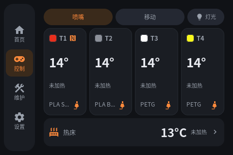 | 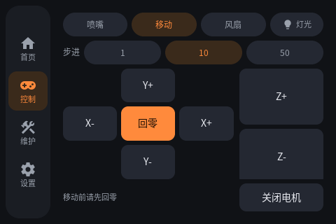 |
| **控制（风扇）** | **控制（循环风扇）** | **打印控制** |
| 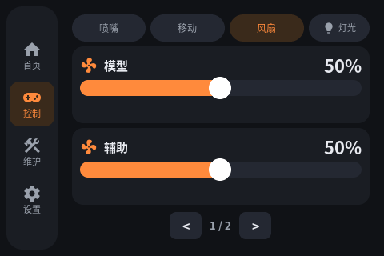 | 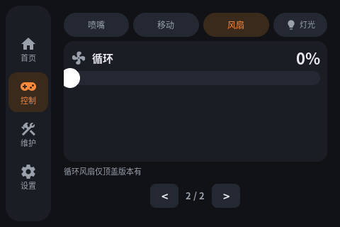 | 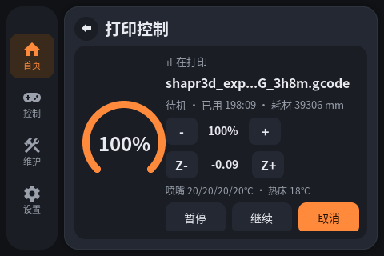 |
| **更换耗材** | **维护** | **网络** |
| 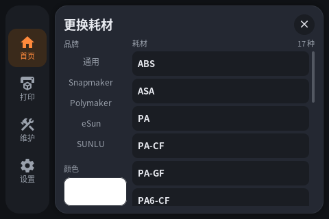 | 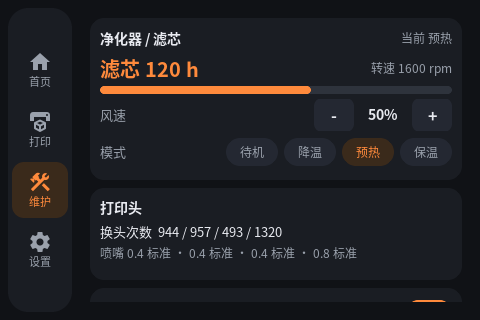 | 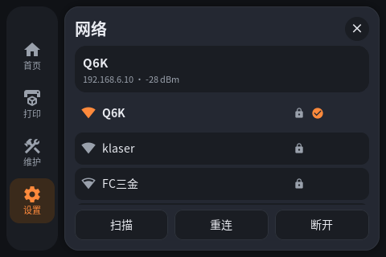 |
| **Wi-Fi 密码** | **进料通知** | **选择文件** |
| 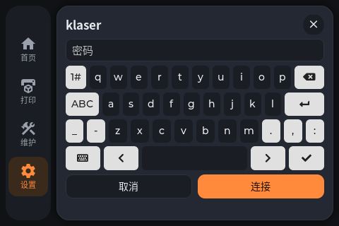 | 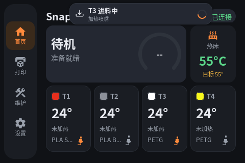 | 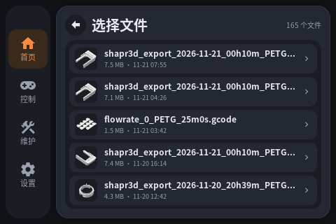 |
| **准备打印 / 耗材映射** |  |  |
| 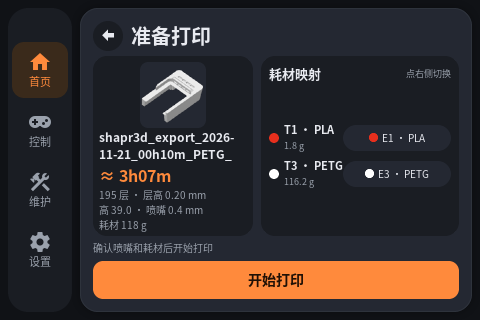 |  |  |

喷嘴详情 / 调温 / 设置页：
[nozzle.png](docs/screenshots/nozzle.png) ·
[temp.png](docs/screenshots/temp.png) ·
[settings.png](docs/screenshots/settings.png)

设置页：[docs/screenshots/settings.png](docs/screenshots/settings.png)

> 设备信息（机型、SN、固件、喷嘴）优先从 Moonraker 的 `/machine/system_info` 读取，
> 和 Snapmaker Orca 用的是同一份数据；仓库里的 `assets/product_info.json` 只是离线开发时的回退示例。

> **只替换屏幕 GUI**：lmd / unisrv / MQTT / Moonraker / 网络模式都不动，
> 原厂 App、Snapmaker 云服务和 Orca 的连接方式保持原样，不要求切 LAN 模式。

## 风险与恢复

接管屏幕的方式是：把 skreeu1 只读 bind mount 到 `/usr/bin/gui`，然后只杀掉 gui 子进程，
让 lmd 用新文件重新拉起。**不会重启 lmd / unisrv** —— 重启它们会把 DRM 显示控制器
留在关闭状态，出现「触摸有反应、画面在更新，但屏幕是黑的」。

但请知悉：

- 需要 root SSH；不同固件版本路径可能不一样，升级固件后可能需要重新适配。
- 打印机重启后会回到**原厂 GUI**，需要再执行一次 `start.sh`。
- 如果原厂 GUI 正好处于息屏状态，先点一下屏幕唤醒再运行 `start.sh`；
  脚本会检查 `bl_power`，息屏时会提示。
- `stop.sh` 随时可以恢复原厂界面；它不会动你的打印配置和耗材数据。
- 本项目直接下发 G-code（例如 `M104` / `M140` / `AUTO_FEEDING`），请在有人的时候测试。
- 作者不对任何设备损坏、打印失败或保修问题负责，使用风险自负。

## 构建（桌面模拟器）

依赖：CMake ≥ 3.16、C++17 编译器、SDL2、FreeType、libpng、libcurl。
LVGL 以 submodule 形式固定在 `v9.4.0`：

```bash
git clone --recurse-submodules https://github.com/jkl8808/skreeu1.git
cd skreeu1
cmake -S . -B build -DCMAKE_BUILD_TYPE=Release
cmake --build build -j
```

或者用 Docker（不必装一堆 dev 包）：

```bash
docker build -t skreeu1-dev:1 -f docker/Dockerfile.dev .
docker run --rm --network host -v $PWD:/src -w /src skreeu1-dev:1 \
  bash -c 'cmake -S . -B build -DCMAKE_BUILD_TYPE=Release && cmake --build build -j'
```

## 运行

桌面版是 SDL2 窗口 + 鼠标，可以连任何 Moonraker：

```bash
# 连真机（只读，最安全）
./build/skreeu1 --host 192.168.1.50 --port 7125 --readonly

# 可写模式（会真的下发 G-code）
./build/skreeu1 --host 192.168.1.50 --port 7125

# Xvfb + VNC，适合远程看 480×320 的实际效果
scripts/run_vnc.sh --host 192.168.1.50 --readonly

# 无头截图（等 1.8s 填状态后出图）
./build/skreeu1 --shot out.png --page 0 --host 192.168.1.50 --readonly
```

| 参数 / 环境变量 | 含义 |
| --- | --- |
| `--host` / `SKREEU1_HOST` | Moonraker 主机（默认 `127.0.0.1`） |
| `--port` / `SKREEU1_PORT` | Moonraker 端口（默认 `7125`） |
| `--readonly` / `SKREEU1_READONLY=1` | 只轮询，所有写命令都不下发 |
| `SKREEU1_FONTS` | 字体目录（默认 `assets/fonts`；设备上是 `/userdata/skreeu1/assets/fonts`） |
| `SKREEU1_PRODUCT_INFO` | 离线时回退用的 `product_info.json` 路径（默认 `/oem/printer_data/config/snapmaker/product_info.json`） |
| `SKREEU1_RAIL=right` | 导航栏换到右侧 |
| `--shot out.png --page N [--scroll N]` | 无头渲染一张 PNG |
| `--sheet N` | 截图时打开第 N 个喷嘴（0–3）的详情 |
| `--temp` | 配合 `--sheet`，打开喷嘴调温浮层 |
| `--bed` | 打开热床调温浮层 |
| `--ctrl N` | 打开控制页并切到第 N 个子标签（0=喷嘴，1=移动，2=风扇） |
| `--fan-page N` | 配合 `--ctrl 2`，切到风扇的第 N 页（0=模型/辅助，1=循环） |
| `--print` | 打开打印控制浮层 |
| `--keypad [--slot N]` | 打开数字键盘（`--slot` 为快捷温度槽位） |
| `--picker` | 打开材料选择 |
| `--nozzle` | 打开喷嘴参数弹层 |
| `--color` / `--toast` | 打开颜色面板 / 显示顶部通知 |
| `--bench N` | 整屏重绘基准（平均 ms/帧、等效 fps） |

## 交叉编译（aarch64 / Buildroot）

目标机是 glibc 2.38 + gcc 12。链接时用机器上真正在跑的
`libfreetype.so.6` / `libpng16.so.16` / `libcurl.so.4`，
`libstdc++` / `libgcc` 静态链入，产物约 1.4MB。

这些库有版权，**不放在仓库里**，先从自己的打印机拷一份：

```bash
scripts/fetch_sysroot.sh root@192.168.1.50
```

然后编译：

```bash
docker build -t skreeu1-cross:1 -f docker/Dockerfile.cross .
docker run --rm --user $(id -u):$(id -g) -e HOME=/tmp \
  -v $PWD:/src -w /src skreeu1-cross:1
```

产物在 `build-aarch64/skreeu1`。

## 安装到打印机

```bash
# 拷贝二进制 + 字体 + 启停脚本到 /userdata/skreeu1/
scripts/install_device.sh root@192.168.1.50

# 只更新二进制（字体已经拷过）
scripts/install_device.sh root@192.168.1.50 --no-fonts

# 装完直接接管屏幕
scripts/install_device.sh root@192.168.1.50 --start
```

在打印机上手动控制：

```sh
/userdata/skreeu1/start.sh    # skreeu1 接管屏幕，官方服务继续运行
/userdata/skreeu1/stop.sh     # 恢复原厂 GUI
SKREEU1_READONLY=1 /userdata/skreeu1/start.sh   # 只读模式
```

`start.sh` 的流程是：确认 lmd 在跑、屏幕是亮的 → 杀掉原厂 gui → 把 skreeu1 只读 bind 到
`/usr/bin/gui` → 再杀一次 gui，让 lmd 拉起 skreeu1。整个过程 lmd / unisrv 都不重启，
DRM 显示控制器保持打开。

程序空闲 5 分钟后把背光 `bl_power` 写成 4 熄屏，DRM 显示输出保持开启；
触摸按下时立即写回 0 唤醒，并吞掉这一次点击，不会误触界面。
超时时间可以用 `SKREEU1_SCREEN_OFF`（秒，0 = 不熄屏）或
`/userdata/skreeu1/skreeu1_screen.cfg` 调整。

设备上没有 SDL 视频驱动，所以真机走 LVGL 自带的 `lv_linux_fbdev`
（`/dev/fb0`，480×320×32）+ `lv_evdev`（`/dev/input/event0`）。
可以用 `SKREEU1_FB` / `SKREEU1_TOUCH` 覆盖设备节点。

## 操作说明

### 首页

- 左侧 3/4：大状态卡，显示进度环、状态、文件名、层数 / 用时
- 右侧 1/4：灯光开关、暂停 / 继续（同一个按钮，按当前状态切换）、停止
- 点状态卡：打开速度倍率 / Z-offset / 进度浮层
- 顶部通知可以**上滑隐藏**，进料结束后自动恢复

### 文件选择 / 准备打印

- 待机时点首页状态卡，列出机内 G-code（按修改时间倒序，带缩略图）
- 点文件进入准备页：预估时间、层数、层高、模型高度、喷嘴直径、耗材总重
- **耗材映射**：G-code 里的 T1..T4 对应到打印机上的 E1..E4，点右侧按钮切换；
  默认按耗材种类和颜色自动匹配最合适的槽位
- 喷嘴直径或高流量类型不匹配、或映射到未识别耗材时，下方会直接提示；
  喷嘴不匹配时「开始打印」置灰，避免 Klipper 拒绝
- 开始打印使用与 Moonraker 相同的 `SDCARD_PRINT_FILE_WITH_PARAMETERS` 参数
  （层高、喷嘴温度、耗材用量、映射表等），不会绕过原厂打印流程

### 控制页

- 顶部子标签：喷嘴 / 移动 / 风扇；右上角是腔体灯开关按钮
- **喷嘴**：4 个喷嘴卡（点开详情、调温、换耗材），热床卡在最底下（点开调温）
- **移动**：步进 1 / 10 / 50 mm，X/Y 点动、Z 升降、回零、关闭电机
- **风扇**：第一页 模型（`fan`）+ 辅助（`cavity_fan`），第二页 循环（`circulation_fan`，仅顶盖版本有）
  每页用滑条控制 0–100%，没有快捷数字
- 未回零时 X/Y/Z 方向键会置灰，并显示「未回零：请先点回零」；点回零后自动恢复
- 回零过程会显示「正在回零…」，等 Klipper 真正执行完（约 40 秒）才提示完成，
  不会再因为 G28 耗时较长误报“发送失败”
- 回零失败时直接显示 Klipper 返回的错误信息；即使误触移动，也会先检查
  `toolhead.homed_axes`，不会把 G-code 错误直接抛出来

### 喷嘴详情

从控制页点喷嘴卡进入。左侧耗材卡（颜色、类型、厂商、NFC 卡型与建议温度），右侧温度卡，下面自动预进料和喷嘴参数，
底部是载入 / 退料 / 完成。

- 点温度卡 → 调温浮层
- 点「喷嘴」→ 改直径（0.2/0.4/0.6/0.8）和流量（标准/高流），打印中不允许改
- 点耗材卡（非官方 RFID）→ 更换耗材：左侧品牌列、左下颜色块（28 色）、右侧型号列表

### 调温浮层

- 竖向滑块拖动时数字实时跟随，**松手才下发** `M104`（喷嘴）或 `M140`（热床）
- 点大字数字 → 数字键盘手动输入
- 6 个快捷温度：点击立即设温，长按弹键盘改数值
- 滑块上限：喷嘴 300°C，热床 120°C

### 配置文件

设备上都在 `/userdata/skreeu1/`，桌面版默认读当前目录：

| 文件 | 内容 | 覆盖变量 |
| --- | --- | --- |
| `skreeu1_brands.cfg` | 品牌列表，一行一个（`generic` 显示为「通用」） | `SKREEU1_BRANDS` |
| `skreeu1_types.cfg` | 自定义类型，一行 `TYPE` 或 `TYPE SUBTYPE`，`#` 注释 | `SKREEU1_TYPES` |
| `skreeu1_temps.cfg` | 喷嘴 6 个快捷温度 | `SKREEU1_TEMPS` |
| `skreeu1_bed_temps.cfg` | 热床 6 个快捷温度 | `SKREEU1_BED_TEMPS` |
| `skreeu1_screen.cfg` | 空闲熄屏秒数（默认 300，0 = 不熄屏） | `SKREEU1_SCREEN_OFF` |

改品牌/类型不需要重启，下次打开更换界面时重读；快捷温度启动时读。

## 网络管理

设置页底部的「网络」卡片会显示当前 SSID 和 IP，点进去是 Wi-Fi 面板：

- 自动扫描并列出周围网络（按信号排序，带锁图标和信号强度）
- 点开放网络直接连接；点加密网络弹出密码键盘（支持大小写/符号，密码不回显）
- 已连接的网络会高亮并打勾，底部可以「扫描」或「断开」
- 连接状态、IP、RSSI 每 3 秒刷新，失败会弹提示
- 「重连」按钮会重连；如果 `wpa_supplicant` 已经不在了，按钮变成「重启服务」，
  会重新拉起服务，不用整机重启
- 看门狗：服务消失超过 10 秒自动重启一次（60 秒冷却），日志在
  `/userdata/logs/skreeu1-wifi.log`

实现上直接调用打印机自带的 `wpa_cli` / `wpa_supplicant`（和原厂 GUI 同一套配置，
`/home/lava/printer_data/gui/wpa_supplicant.conf`），DHCP 继续由系统的 `dhcpcd` 处理。

连接新网络前会先备份配置，**只有确认连上并且拿到 IP 才写盘**；失败时会恢复备份并
`reconfigure`，保证不会把原来的网络写坏、重启后还能自动连回去。
（有些 AP 能关联但不发 DHCP，这种情况也会按失败处理。）
WPA3-SAE 会自动识别；过渡模式（WPA2-PSK+SAE）用 WPA2-PSK 连接。
接口默认 `wlan0`，可用 `SKREEU1_WIFI_IF` 覆盖。

## 自定义耗材小工具

`tools/filament_tool.py` 在电脑上运行：通过 SSH 改打印机的品牌/类型列表，
通过 Moonraker 把某个喷嘴设成这卷耗材，可选同时生成 Snapmaker Orca 的用户预设。

```bash
export SKREEU1_HOST=192.168.1.50       # 或者每次传 --host

# 看现有品牌/类型/喷嘴状态
python3 tools/filament_tool.py list

# 加品牌 + 类型，设到 T3，并生成 Orca 的 4 个喷嘴预设
python3 tools/filament_tool.py add --vendor Kexcelled --type ABS --sub Basic \
    --color "#FFFFFF" --tool 2 --orca

# 不带参数进入交互模式
python3 tools/filament_tool.py
```

| 环境变量 | 含义 |
| --- | --- |
| `SKREEU1_HOST` | 打印机地址（必填） |
| `SKREEU1_SSH_USER` | SSH 用户，默认 `root` |
| `SKREEU1_SSH_PASS` | SSH 密码；不填会在运行时提示输入 |
| `SKREEU1_PORT` | Moonraker 端口，默认 `7125` |

打印机侧和切片软件侧的数据怎么对应，见
[docs/custom_filament.md](docs/custom_filament.md)。

## 原厂功能是怎么接进来的

没有逆向闭源 GUI，只是把原厂已经在用的 Klipper 对象和 G-code 命令接到 LVGL 上。
完整的对象/命令映射、固件里的约束（官方 RFID 不可改、打印中不能改喷嘴参数等）见
[docs/compat.md](docs/compat.md)。

## 目录结构

```
src/            UI、主题、Moonraker 客户端、fbdev/evdev 入口
assets/fonts/   Noto Sans CJK SC + Material Design Icons
device/         打印机上的 start.sh / stop.sh
scripts/        交叉编译、安装、取 sysroot、VNC、截图
tools/          filament_tool.py（自定义耗材）
docs/           兼容层说明、自定义耗材说明、截图
lvgl/           LVGL 9.4.0（git submodule）
third_party/    nlohmann/json
```

## 已知限制

- 摄像头 / 延时摄影、OTA、局域网访问码、云端账号仍由 unisrv 负责，skreeu1 不接管；
  所以原厂 App、Snapmaker 云服务和 Orca 都按原样工作，不要求切到 LAN 模式。
- 只在 U1 / 固件 2.1.0 上验证过；其他固件版本的对象名和命令可能不同。
- Wi-Fi 面板暂不支持手动输入隐藏 SSID，也没有做 Wi-Fi 射频开关（只做连接/断开）。
- 看门狗依赖 `wpa_supplicant` 二进制和原厂 `/home/lava/printer_data/gui/wpa_supplicant.conf`；
  文件缺失时只会提示，不会乱猜配置。
- 连接新网络会改写 `wpa_supplicant.conf` 里的保存网络，和原厂 GUI 的行为一致。
- 界面固定按 480×320 设计，没有做其他分辨率适配。

## 许可证

本项目代码使用 [MIT](LICENSE)。第三方组件（LVGL、nlohmann/json、Noto CJK、Material Design Icons）
按各自许可证分发，详见 [THIRD_PARTY.md](THIRD_PARTY.md)。
